# Cahier des charges — UptimePulse

Document de référence contractuel : ce que le produit est censé faire, ce qu'il fait réellement, ce qu'il ne fait pas, et à quelles conditions on considère le travail terminé.

## 0. Fiche d'identité

| Champ                               | Valeur                                                                                                                                                                                                     |
| ----------------------------------- | ---------------------------------------------------------------------------------------------------------------------------------------------------------------------------------------------------------- |
| Produit                             | UptimePulse — surveillance de disponibilité HTTP/HTTPS avec page de statut publique et module qualité/support                                                                                              |
| Dépôt déclaré                       | `https://github.com/ventso00/uptimepulse` — **pas encore créé**                                                                                                                                            |
| Dépôt réellement configuré en local | aucun remote : `git remote -v` ne renvoie rien. La mention d'un `UptimePusle.git` (faute de frappe) a été mesurée le 2026-10-12 sur une autre machine de développement ; le dépôt local repart sans remote |
| Branche de travail                  | `refactor/restructure-architecture`, sept commits depuis `979ed3a chore: baseline snapshot of the working tree` ; `main` s'arrête à `df4db5c` et en compte cinq (mesuré le 2026-10-19)                     |
| État de publication                 | Aucun commit poussé ; la CI (`ci.yml`, déclenchée sur `push`/PR vers `main`) n'a donc **jamais** été exécutée                                                                                              |
| Exécution validée                   | Build de production servi localement sur `http://127.0.0.1:3000`, portes au vert, 23 fichiers / 223 tests (mesuré le 2026-10-19)                                                                           |
| Date du document                    | 2026-10-19                                                                                                                                                                                                 |

L'historique Git commence par un instantané du répertoire de travail : les six
commits qui suivent portent sur du code et de la documentation déjà écrits,
aucune archéologie du développement antérieur n'est donc possible à partir du
dépôt, et tout ce qui précède vient de la lecture du code ou d'une exécution
mesurée.

**Méthode.** Chaque affirmation de ce document provient de la lecture du code ou d'une exécution mesurée. Rien n'est déduit d'un nom de fichier, d'un bouton ou d'une documentation existante. Quand un écart est constaté entre la documentation et le code, l'écart est écrit §11.

---

## 1. Contexte et problème

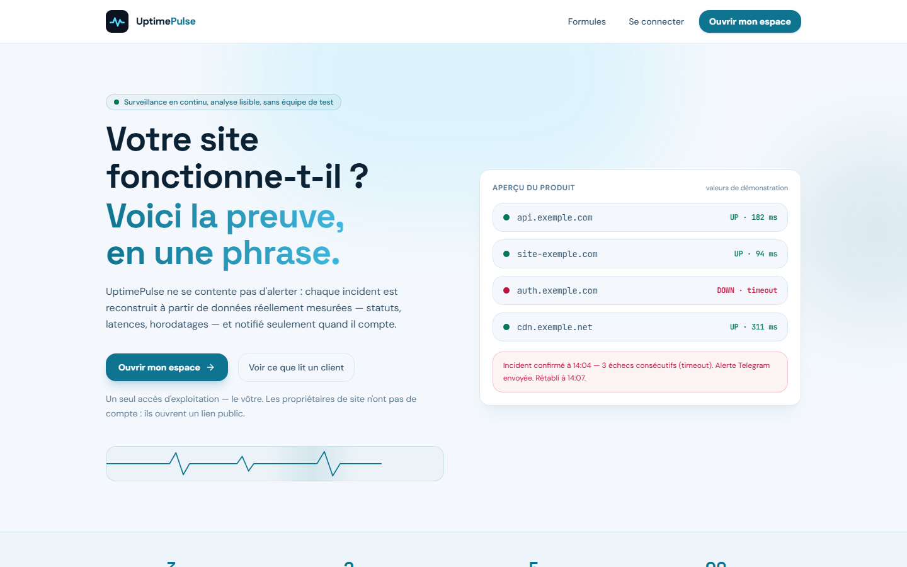
_Figure 1 — `/` en régime clair, avant toute inscription. C'est la porte d'entrée du produit observé : le visiteur voit la promesse, les limites et les paliers sans créer de compte._

Un propriétaire de site ne sait pas immédiatement que son site ou son API est indisponible. Les outils existants envoient une alerte ; ils n'envoient pas de preuve. Quand l'alerte arrive, il faut encore retrouver ce qui a échoué, depuis quand, ce que le client voyait, et quoi répondre.

UptimePulse répond à ce problème en deux temps : **mesurer** une disponibilité avec des données réellement observées (statut, code HTTP, latences par phase, certificat, contenu), puis **transformer** cette mesure en artefacts exploitables par un humain — incident prouvé, page de statut lisible par le client, ticket qualité documenté, rapport interne, réponse client en français.

## 2. Vision et chaîne de valeur

La chaîne visée, dans l'ordre : observation → détection d'anomalie → collecte de preuve → test reproductible → analyse → rapport d'incident → ticket → suivi → vérification → synthèses.

État mesuré de chaque maillon :

| Maillon              | État             | Ce qui existe                                                                                                                         | Ce qui manque                                                                                                                        |
| -------------------- | ---------------- | ------------------------------------------------------------------------------------------------------------------------------------- | ------------------------------------------------------------------------------------------------------------------------------------ |
| Observation          | **opérationnel** | checks périodiques planifiés en base, moteur de vérification complet                                                                  | —                                                                                                                                    |
| Détection d'anomalie | **partiel**      | règles d'incident déterministes (3 échecs / 2 succès), invariants d'auto-test                                                         | aucune détection statistique : pas d'Isolation Forest, pas de z-score, pas d'IQR sur la latence ou le taux d'erreur                  |
| Collecte de preuve   | **partiel**      | preuves structurées du navigateur (route, viewport, erreurs JS, appels API en échec), phases réseau et certificat horodatés par check | aucune capture d'écran, aucun enregistrement, aucun stockage binaire                                                                 |
| Test reproductible   | **partiel**      | 7 invariants rejoués toutes les 15 min, 1 test fonctionnel de la page publique par jour                                               | ces tests sont des agrégats SQL en lecture seule, pas des appels HTTP contre l'application ; les scénarios ne sont pas configurables |
| Analyse              | **opérationnel** | agrégats de statut, percentiles exacts, décomposition de latence, causes d'échec agrégées, lecture préliminaire de ticket             | —                                                                                                                                    |
| Rapport d'incident   | **partiel**      | rapport interne Markdown déterministe, chronologie d'incident persistée                                                               | pas de lien incident ↔ ticket QA                                                                                                    |
| Ticket               | **opérationnel** | dossier unique client/auto/interne, statuts, sévérités, natures, chronologie à deux visibilités                                       | —                                                                                                                                    |
| Suivi                | **opérationnel** | relance automatique à 48 h, transitions gardées, lien de suivi tokenisé aller-retour                                                  | pas d'affectation nominative, pas de filtre par sévérité, pas de recherche                                                           |
| Vérification         | **partiel**      | le client doit confirmer la résolution pour que le dossier passe clos                                                                 | aucune vérification automatique que le correctif tient                                                                               |
| Synthèses            | **partiel**      | point quotidien complet, calculé puis rejoué à la lecture                                                                             | **jamais livré à un humain** : son seul effet de bord est un `console.log`                                                           |

## 3. Périmètre

**Dans le périmètre.** Supervision HTTP/HTTPS d'URL publiques ; assertion de contenu par mot-clé ; mesure des phases réseau et du certificat ; incidents confirmés et résolus ; alertes Telegram ; page de statut publique analysée ; module qualité/support complet ; paliers freemium éditables en base ; console créateur ; auto-tests et point quotidien ; rétention automatique.

**Hors périmètre, décidé — pas oublié** : paiement en ligne (`priceCents` est un affichage, l'affectation d'un palier payant est un geste d'administrateur) ; multi-opérateur ; i18n ; application desktop ou PWA ; assistance par IA ; transport de messagerie électronique ; fenêtres de maintenance ; types de monitor autres que HTTP/HTTPS (pas de Ping, Port, DNS, Cron, Heartbeat).

## 4. Utilisateurs et modèle d'accès

Trois populations, deux interfaces, un seul compte opérable.

| Population                   | Compte                                                                                                | Ce qu'elle peut faire                                                                                                |
| ---------------------------- | ----------------------------------------------------------------------------------------------------- | -------------------------------------------------------------------------------------------------------------------- |
| Créateur / exploitant        | un seul, identifié par `UPTIMEPULSE_OWNER_EMAIL` (défaut l'adresse posée dans `server/auth/owner.ts`) | tout le tableau de bord, `/qa`, `/settings`, `/console` — même régime clair que les surfaces clientes depuis ADR-018 |
| Propriétaire de site observé | aucun                                                                                                 | lit `/status/:slug`, signale un problème, suit son dossier sur `/support/:token`                                     |
| Visiteur                     | aucun                                                                                                 | lit la landing, la page de statut, tente `/register`                                                                 |

Règles d'accès mesurées dans le code :

- `POST /api/auth/register` refuse toute adresse autre que celle du propriétaire **avant** de hacher le mot de passe : `403 REGISTRATION_CLOSED` (`server/auth/routes.ts:89-95`, `server/auth/owner.ts:8-21`).
- Une adresse valide mais non propriétaire, un mot de passe erroné et un e-mail inconnu renvoient le **même** `401 INVALID_CREDENTIALS` ; l'e-mail inconnu est tout de même vérifié contre un hash factice pour que le coût bcrypt soit identique (`server/auth/routes.ts:17-18, 181-202`).
- Un compte valide mais non propriétaire est refusé à chaque appel protégé : `403 ACCESS_RESERVED` dans `requireUser` (`server/_core/http.ts:62-96`).
- La session est un cookie `uptimepulse_session`, `httpOnly`, `secure`, `sameSite=none`, 30 jours ; le serveur ne stocke que son empreinte SHA-256 (`server/auth/session.ts:8-39`).

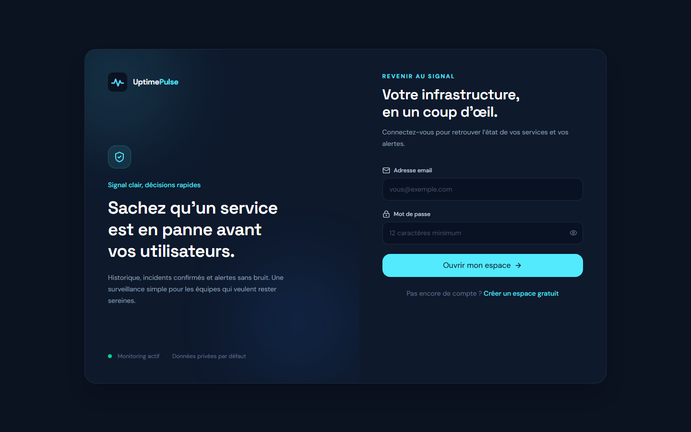
_Figure 2 — `/login`. Le formulaire est le seul chemin d'entrée de l'espace d'exploitation ; une adresse qui n'est pas celle du propriétaire y est refusée sans distinction du mauvais mot de passe. Cette capture montre l'ancien régime sombre : depuis ADR-018, `/login` rend en clair comme le reste du produit._

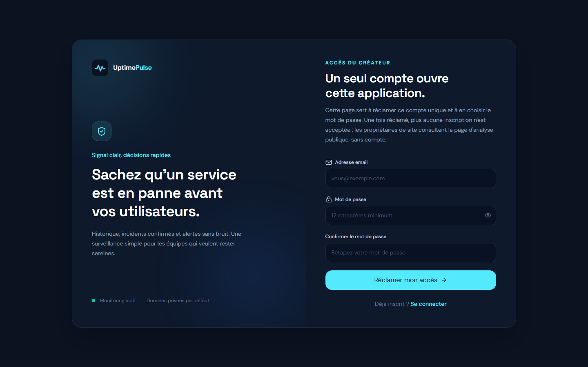
_Figure 3 — `/register`. La page reste ouverte pour que le créateur puisse réclamer son compte ; elle refuse toute autre adresse. Même réserve de régime que pour la figure 2._

## 5. Exigences fonctionnelles

Chaque exigence porte son statut mesuré : **ACQUIS** (implémenté et vérifié), **PARTIEL**, **ABSENT**.

### 5.1 Cycle de vie d'un service surveillé

| id    | Exigence          | Règle exacte                                                                                                                                                                                                                                                                                      | Statut |
| ----- | ----------------- | ------------------------------------------------------------------------------------------------------------------------------------------------------------------------------------------------------------------------------------------------------------------------------------------------- | ------ |
| EF-01 | Créer un monitor  | `intervalSeconds` 300, `timeoutMs` 10 000, `enabled` vrai, statut `UNKNOWN`, `nextCheckAt = maintenant` ; comptage et insertion dans **une seule transaction** (`server/monitors/routes.ts:193-199`)                                                                                              | ACQUIS |
| EF-02 | Bornes saisie     | intervalle 300–86 400 s, timeout 1 000–30 000 ms, nom ≤ 120, URL ≤ 2 048, mot-clé ≤ 160 (`shared/contracts.ts:12-13, 29-32`)                                                                                                                                                                      | ACQUIS |
| EF-03 | Quota de création | dépassement → `409 QUOTA_EXCEEDED` ; mot-clé hors plan → `403 FEATURE_UNAVAILABLE` ; intervalle/timeout hors plan → `400 VALIDATION_ERROR` (`server/plans/respond.ts:13-43`)                                                                                                                      | ACQUIS |
| EF-04 | Modifier          | correctif **partiel** : seul ce qui est fourni est écrit ; un `keyword` absent laisse la règle en place, un `keyword: null` explicite la supprime ; `enabled`, statut et compteurs ne sont pas modifiables par `PUT` ; tout `PUT` reprogramme `nextCheckAt` (`server/monitors/routes.ts:405-423`) | ACQUIS |
| EF-05 | Pause / reprise   | pause → `enabled=false`, statut `PAUSED` ; reprise → statut `UNKNOWN` ; les deux remettent les compteurs à zéro ; vérification forcée sur monitor en pause → `409 MONITOR_PAUSED` (`server/monitors/routes.ts:566-575, 492-497`)                                                                  | ACQUIS |
| EF-06 | Supprimer         | suppression définitive, propriétaire vérifié, `204` ; cascades `ON DELETE CASCADE` sur historique, incidents et notifications (`shared/db/schema.ts:174, 210`)                                                                                                                                    | ACQUIS |
| EF-07 | Historique paginé | périodes 24 h / 7 j / 30 j, `limit ≤ 500`, curseur `before` (`server/monitors/routes.ts:227`)                                                                                                                                                                                                     | ACQUIS |

### 5.2 Moteur de vérification

L'ordre d'exécution est contractuel ; il est reproduit tel quel depuis `server/checks/engine.ts` et `server/checks/client.ts`.

| #   | Étape            | Règle                                                                                                                                                                                               | Source                                     |
| --- | ---------------- | --------------------------------------------------------------------------------------------------------------------------------------------------------------------------------------------------- | ------------------------------------------ |
| 1   | Réserve atomique | un seul `UPDATE … SET nextCheckAt = maintenant + 6 min WHERE enabled AND nextCheckAt <= maintenant` ; `affectedRows = 0` ⇒ un autre worker a déjà pris le check                                     | `server/checks/engine.ts:97-108`           |
| 2   | Syntaxe URL      | http/https uniquement ; **ni identifiants ni port explicite** ; `localhost` et `*.localhost` refusés ; hôte 1–253 caractères                                                                        | `server/monitors/ssrf.ts:62-102`           |
| 3   | Résolution SSRF  | résolution DNS anticipée, **toutes** les adresses validées contre 22 blocs CIDR                                                                                                                     | `server/monitors/ssrf.ts:15-46, 118-134`   |
| 4   | Connexion        | socket neuf par saut (`agent:false`) pour que les phases soient mesurables ; `lookup` personnalisé qui re-résout et re-valide **au moment de connecter** — c'est ce qui ferme la fenêtre DNS-rebind | `server/checks/client.ts:237-307`          |
| 5   | Redirections     | 3 sauts maximum, chacun revalidé syntaxe + SSRF ; le 4ᵉ → `DOWN_NETWORK`                                                                                                                            | `server/checks/client.ts:411-430`          |
| 6   | Phases mesurées  | `dnsMs`, `tcpMs`, `tlsMs`, `ttfbMs`, plus `responseTimeMs` total                                                                                                                                    | `server/checks/client.ts:315-341`          |
| 7   | Certificat       | émetteur, sujet (CN→O→OU) et `validTo` lus au `secureConnect`                                                                                                                                       | `server/checks/client.ts:166-184, 386-389` |
| 8   | Corps            | plafond 256 Kio ; au-delà le flux est détruit et le check marqué `truncated` — **jamais** une panne                                                                                                 | `server/checks/client.ts:351-364`          |
| 9   | Contenu          | `must_contain` / `must_not_contain`, insensible à la casse, uniquement sur type texte/JSON/XML/HTML ; une absence sur corps tronqué donne `unknown` et laisse le service **EN LIGNE**               | `server/checks/client.ts:77-115`           |
| 10  | Classification   | 12 valeurs, dont `UP_HTTP_2XX`, `DOWN_HTTP_4XX`, `DOWN_TIMEOUT`, `DOWN_DNS`, `DOWN_TLS`, `BLOCKED_TARGET`, `DOWN_KEYWORD_MISSING`                                                                   | `shared/contracts.ts:78-91`                |
| 11  | Persistance      | historique + transition d'incident + mise à jour du monitor dans **une transaction** ; les notifications partent après commit, sans `await`                                                         | `server/checks/engine.ts:129-260`          |

### 5.3 Incidents et alertes

| id    | Exigence        | Règle                                                                                                                                                                                             | Statut  |
| ----- | --------------- | ------------------------------------------------------------------------------------------------------------------------------------------------------------------------------------------------- | ------- |
| EF-08 | Confirmation    | 1 échec ouvre un incident `suspect` ; le 3ᵞ échec consécutif le confirme, passe le service à `DOWN` et déclenche l'alerte ; 2 succès consécutifs le résolvent (`server/incidents/state.ts:41-81`) | ACQUIS  |
| EF-09 | Rétablissement  | notification d'alerte puis de rétablissement, une seule fois par incident et par canal grâce à l'index unique `(incidentId, channelId, type)`                                                     | ACQUIS  |
| EF-10 | Anti-spam       | un check isolé en échec ne produit **aucune** alerte                                                                                                                                              | ACQUIS  |
| EF-11 | Retries         | 3 tentatives par passe, relancées à chaque tick ; **aucun backoff exponentiel** ; l'âge minimal de 60 s et le pas de 30 s servent de throttle (`server/notifications/dispatcher.ts:54-95`)        | PARTIEL |
| EF-12 | Canal absent    | la requête renvoie vide, rien n'est envoyé, aucune erreur                                                                                                                                         | ACQUIS  |
| EF-13 | Secret du canal | `botToken` + `chatId` chiffrés AES-256-GCM avant stockage (`server/notifications/crypto.ts`)                                                                                                      | ACQUIS  |

**Anomalie mesurée, à corriger (P0).** `server/incidents/state.ts:79` refuse de confirmer un incident suspect si le service est déjà `DOWN` : un service peut donc rester en panne **sans incident confirmé ni alerte**. Cas atteignable notamment après une reprise. Aucun test ne le couvre aujourd'hui.

### 5.4 Statistiques

| id    | Exigence                | Règle                                                                                                                                                                                                                                                                                                                                                        | Statut |
| ----- | ----------------------- | ------------------------------------------------------------------------------------------------------------------------------------------------------------------------------------------------------------------------------------------------------------------------------------------------------------------------------------------------------------ | ------ |
| EF-14 | Uptime                  | `checks réussis / checks enregistrés × 100`, arrondi à 2 décimales. C'est un uptime **compté en checks**, pas mesuré en temps : un arrêt de l'ordonnanceur ne compte ni comme succès ni comme panne ; 0 ligne ⇒ `null` (`server/monitors/stats.ts:30-33`)                                                                                                    | ACQUIS |
| EF-15 | Fenêtre tableau de bord | 30 jours                                                                                                                                                                                                                                                                                                                                                     | ACQUIS |
| EF-16 | Fenêtre page publique   | 24 h / 7 j / 30 j / 90 j glissants, 90 j = fenêtre de rétention                                                                                                                                                                                                                                                                                              | ACQUIS |
| EF-17 | Percentiles             | p50 / p90 / p95 / **max**, rang le plus proche, échantillon exact ; échantillon = 7 derniers jours de checks EN LIGNE, borné par `LATENCY_SAMPLE_CAP_PER_MONITOR` = 4 320 lignes par service (dont 4 032 = le pire cas théorique à 300 s), valeur **prouvée** non tronquante à l'intervalle minimum de 300 s (`server/statuspages/analysis.ts:36-39, 95-99`) | ACQUIS |
| EF-18 | Calendrier horaire      | 168 buckets UTC fixes ; un trou reste « pas encore de donnée », jamais « panne »                                                                                                                                                                                                                                                                             | ACQUIS |
| EF-19 | Latence serveur         | `TTFB − DNS − TCP − TLS`, plancher 0                                                                                                                                                                                                                                                                                                                         | ACQUIS |
| EF-20 | Objectif                | 99,9 % affiché comme **repère de lecture**, pas comme contrat ; budget d'erreur calculé sur les checks réellement mesurés                                                                                                                                                                                                                                    | ACQUIS |

### 5.5 Page de statut publique

| id    | Exigence              | Règle                                                                                                   | Statut |
| ----- | --------------------- | ------------------------------------------------------------------------------------------------------- | ------ |
| EF-21 | Une page par compte   | contrainte unique sur `status_pages.userId` ; slug unique, 64 caractères                                | ACQUIS |
| EF-22 | Lecture publique      | `GET /api/public/status/:slug`, 60 req/min/IP, payload validé par `publicStatusResponseSchema`          | ACQUIS |
| EF-23 | Verdict en une phrase | généré depuis les chiffres présents, jamais depuis une moyenne marketing                                | ACQUIS |
| EF-24 | Signature de problème | incidents, échecs, certificat à moins de 30 jours, avec puces « Bloquant / À surveiller / Information » | ACQUIS |
| EF-25 | Méthodologie exposée  | panneau dépliable qui énonce les seuils, les fenêtres, la rétention et le mode de calcul                | ACQUIS |

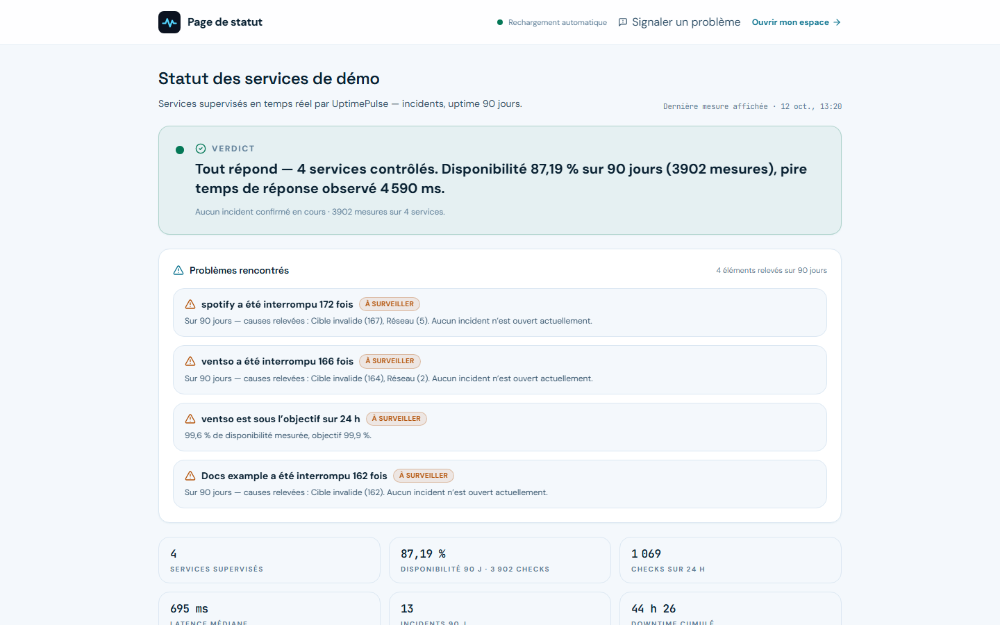
_Figure 4 — `/status/<slug>`, régime clair. Verdict chiffré, problèmes rencontrés, bande de synthèse et légende. Les chiffres affichés proviennent de la base locale de développement au moment de la capture et ne sont pas rejouables ; la page est rendue avec `prefers-reduced-motion` forcé pour la capture._

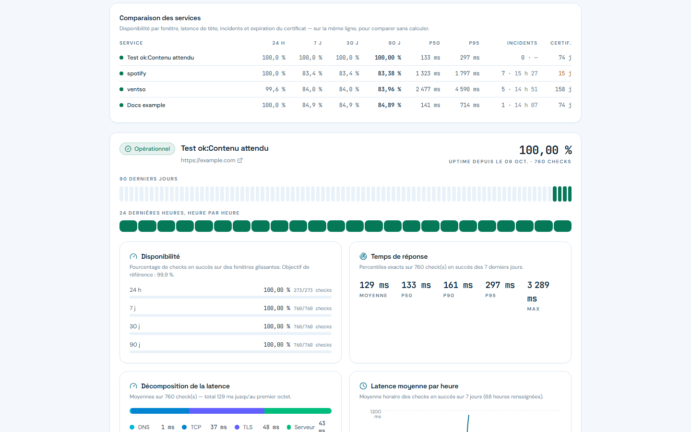
_Figure 5 — Tableau de comparaison : uptime par fenêtre, p50/p95, incidents, jours restants de certificat. La colonne en gras est la fenêtre retenue pour le verdict._

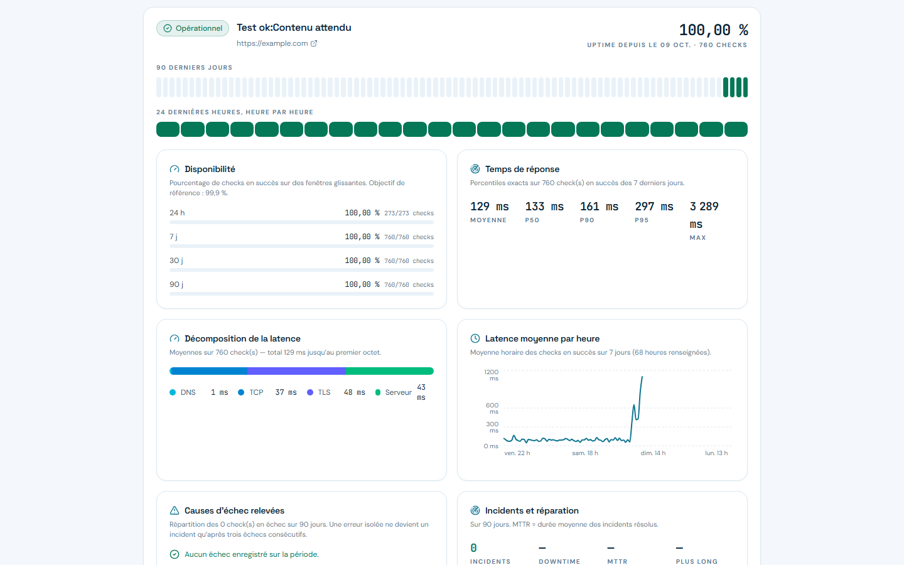
_Figure 6 — Bloc d'analyse par service : disponibilité par fenêtre, percentiles, décomposition DNS/TCP/TLS/serveur, causes d'échec, incidents et réparation, certificat, et « comment ce service est surveillé »._

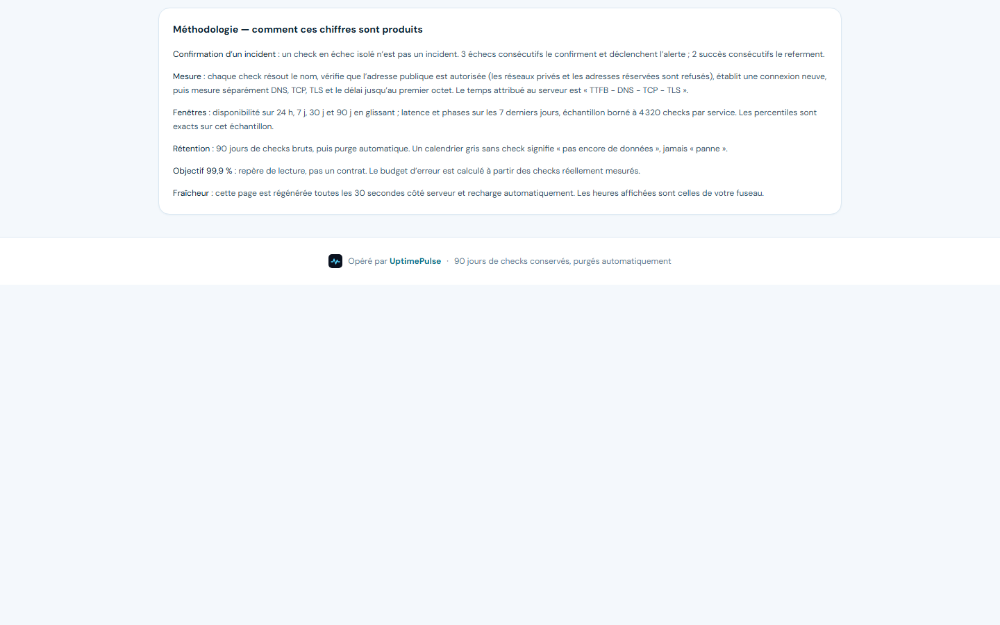
_Figure 7 — Le panneau méthodologie déplie les règles exactes : 3 échecs pour confirmer, 2 succès pour refermer, échantillon borné au `latencySampleCap` réellement publié (4 320), 90 jours de rétention, 99,9 % comme repère et non comme contrat._

### 5.6 Qualité et support

| id    | Exigence                             | Règle                                                                                                                                                                                                                              | Statut                     |
| ----- | ------------------------------------ | ---------------------------------------------------------------------------------------------------------------------------------------------------------------------------------------------------------------------------------- | -------------------------- |
| EF-26 | Signalement public                   | `POST /api/public/qa/tickets`, 10 req/15 min/IP ; honeypot `website` rempli ⇒ `201` **factice** (`id` 0, jeton `"0"×32`) ; référence `UP-XXXXX`                                                                                    | ACQUIS                     |
| EF-27 | Affectation                          | le client ne choisit jamais un identifiant de compte : la page de statut citée désigne son propriétaire, sinon le responsable qualité                                                                                              | ACQUIS                     |
| EF-28 | Documentation de l'anomalie          | colonnes dédiées `steps`, `expected`, `actual`, plus le verbatim `clientMessage` **jamais réécrit**                                                                                                                                | ACQUIS                     |
| EF-29 | Preuves automatiques                 | route sans chaîne de requête, user-agent, langue, viewport, 10 dernières erreurs JS, 10 derniers appels API en échec ; bornes 300/60 caractères appliquées **des deux côtés** ; payload illisible ⇒ `null`, jamais une file cassée | ACQUIS                     |
| EF-30 | **Preuve visuelle**                  | capture d'écran, enregistrement, tout fichier joint                                                                                                                                                                                | **ABSENT**                 |
| EF-31 | Cycle de vie                         | `new → triaged → in_progress → waiting_client → resolved → closed`, `resolved → in_progress` autorisé, `closed` terminal ; transition interdite ⇒ `409 INVALID_TRANSITION`                                                         | ACQUIS                     |
| EF-32 | Note de résolution                   | la transition `PATCH` n'emporte **aucun** texte (`server/qa/routes.ts:487` passe `null`) : il faut poster un événement séparé                                                                                                      | PARTIEL                    |
| EF-33 | Communication bilingue de visibilité | événements `public` / `internal` ; la lecture publique filtre en SQL ; la sérialisation publique est construite champ par champ, verrouillée par un test d'inventaire de clés                                                      | ACQUIS                     |
| EF-34 | Réponses en français                 | trois modèles (accusé, demande de précision, annonce de résolution) ; la demande de précision énumère **exactement** les champs manquants ; interdiction testée : ni date de livraison, ni version, ni cause                       | ACQUIS                     |
| EF-35 | Envoi de la réponse                  | **aucun transport** : `POST …/reply` n'écrit rien, l'opérateur copie ou publie en note visible. Cet endpoint est de plus le seul du module à ne pas être limité en débit                                                           | PARTIEL                    |
| EF-36 | Suivi client aller-retour            | `/support/:token` : lecture des événements publics **et** envoi d'un complément, qui replace automatiquement `waiting_client → in_progress`                                                                                        | ACQUIS                     |
| EF-37 | Relance                              | 48 h sans activité ⇒ relance, prioritaire **même sur dossier clos** ; la constante est partagée avec 4 consommateurs                                                                                                               | ACQUIS                     |
| EF-38 | Déduplication                        | `fingerprint` unique, remis à `null` à la fermeture : une anomalie persistante met à jour un dossier, une réapparition en ouvre un nouveau                                                                                         | ACQUIS                     |
| EF-39 | Auto-tests                           | 7 invariants, 15 min, clé de période UTC ; une exception devient « Test impossible », jamais un succès ; `actual` chiffré avec exemples                                                                                            | PARTIEL (aucun appel HTTP) |
| EF-40 | Point quotidien                      | 6 sections, idempotence par `qa_runs (kind, periodKey)` ; la relecture **rejoue** le point et recalcule les compteurs au lieu de relire le blob stocké                                                                             | ACQUIS                     |
| EF-41 | **Livraison du point**               | son seul effet de bord est un `console.log` ; `server/notifications/` ne référence ni ticket, ni digest                                                                                                                            | **ABSENT**                 |
| EF-42 | Triage de file                       | filtres statut et origine seulement ; pas de filtre sévérité, pas de recherche, pas de tri, pas d'affectation nominative                                                                                                           | PARTIEL                    |

> **Figure 8 — Absence assumée (aucune image).** Les six écrans d'exploitation (`/dashboard`, `/monitors/:id`, `/settings`, `/qa`, `/support/:token`, `/console`) ne peuvent pas être capturés ici, parce que la session exige le mot de passe du compte propriétaire, que ce document ne manipule ni ne stocke. §10, réserve 2, explique comment les obtenir.

### 5.7 Paliers et quotas

| id    | Exigence             | Règle                                                                                                                                                                                                                                                 | Statut  |
| ----- | -------------------- | ----------------------------------------------------------------------------------------------------------------------------------------------------------------------------------------------------------------------------------------------------- | ------- |
| EF-43 | Paliers en base      | table `plans`, éditables depuis `/console` ; le palier intégré `free` (3 monitors, 300 s, 30 000 ms, 1 canal, sans mot-clé) reste une constante pour qu'aucun compte ne soit verrouillé par une suppression en base (`server/plans/service.ts:23-33`) | ACQUIS  |
| EF-44 | Garde-fous d'édition | `minIntervalSeconds` ne peut descendre sous 300 s (l'échantillon des percentiles est dimensionné sur cette valeur) ; `slug` immuable ; un compte dont le palier a disparu est réancré sur le repli intégré                                            | ACQUIS  |
| EF-45 | Baisser un quota     | ne supprime rien : le surnombre devient visible                                                                                                                                                                                                       | ACQUIS  |
| EF-46 | Essai                | `trialDays` 0–365, `trialEndsAt = maintenant + jours` ; **rien ne le consomme automatiquement**, c'est un geste d'administrateur                                                                                                                      | PARTIEL |
| EF-47 | Tarifs publics       | `GET /api/plans` public, cache 60 s ; l'ordre du landing est le prix avec `free` épinglé, pas `sortOrder`                                                                                                                                             | ACQUIS  |

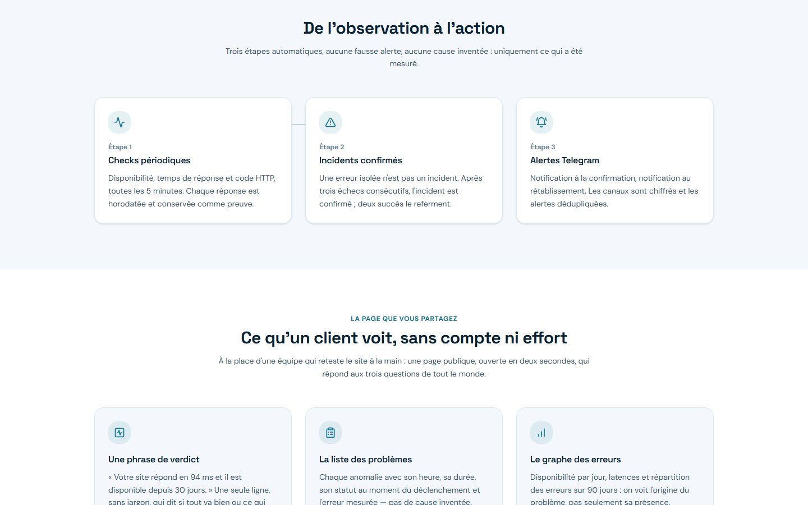
_Figure 9 — La landing explique la chaîne « de l'observation à l'action » avant toute inscription._

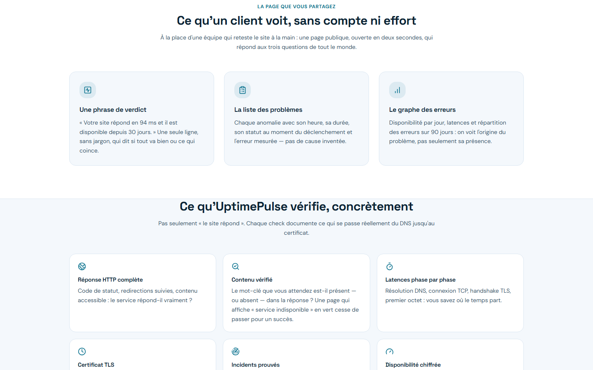
_Figure 10 — Section « Ce qu'un client voit, sans compte ni effort » : la page de statut est vendue comme artefact, pas comme gadget._

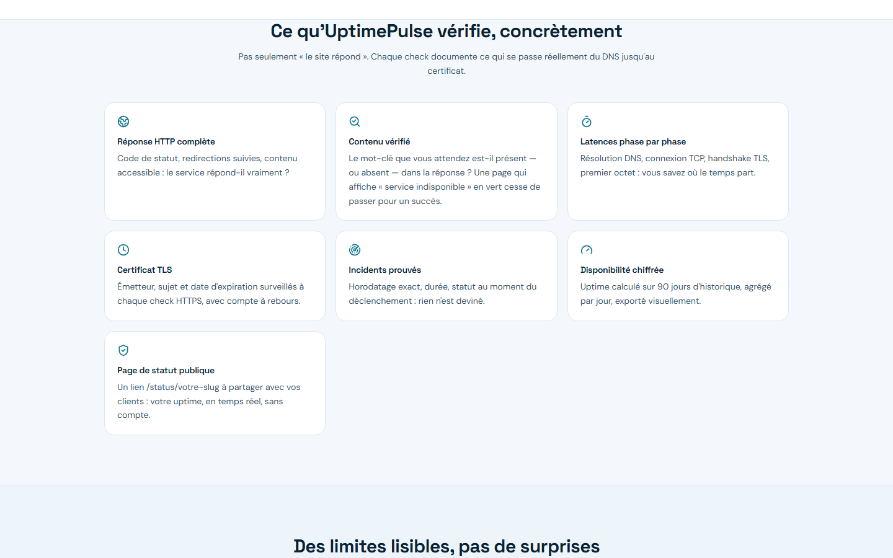
_Figure 11 — Sept points vérifiés concrètement, dont la réponse HTTP complète, le contenu, les latences par phase et le certificat._

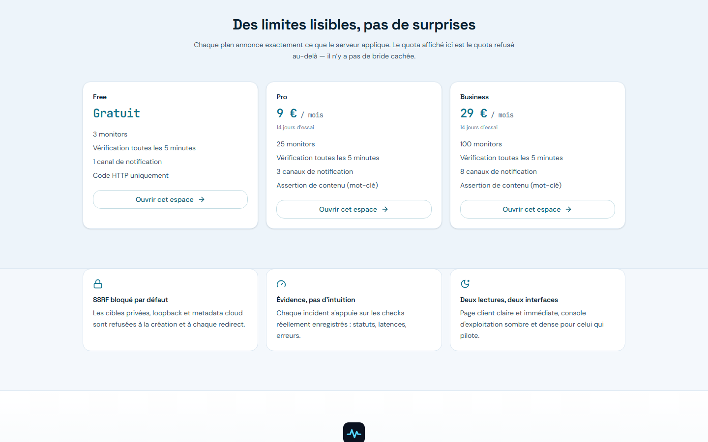
_Figure 12 — « Des limites lisibles, pas de surprises » : les paliers lus en base, affichés sans promesse de paiement en ligne._


_Figure 13 — Vue intégrale de `/` (1440 × 4 134), pour la mise en page et la hiérarchie de sections._

### 5.8 Ordonnancement et conservation

| id    | Exigence      | Règle                                                                                                                                                                  | Statut |
| ----- | ------------- | ---------------------------------------------------------------------------------------------------------------------------------------------------------------------- | ------ |
| EF-48 | Tick interne  | 30 s, première passe +2 s, single-flight par drapeau `running` ; désactivable par `SCHEDULER_INTERNAL=0`                                                               | ACQUIS |
| EF-49 | Ordre du tick | retries de notification (20, ≥ 60 s) → monitors dus (lot de 50, concurrence 10) → purge de rétention → auto-tests → point quotidien (`server/scheduler/tick.ts:92-93`) | ACQUIS |
| EF-50 | Double voie   | la même passe est déclenchable par `POST /api/scheduled/checks` avec cookie `cron_` signé, pour un cron externe                                                        | ACQUIS |
| EF-51 | Rétention     | sessions expirées, historiques et livraisons de plus de 90 jours, `DELETE … LIMIT 1000` par table et par tick ; incidents et monitors ne sont jamais purgés            | ACQUIS |

## 6. Exigences non fonctionnelles

| id     | Exigence                                                                                                                                                                              | État mesuré                                                                                                                                                                                                                                                                                                                                                                                                                                                                                                                            |
| ------ | ------------------------------------------------------------------------------------------------------------------------------------------------------------------------------------- | -------------------------------------------------------------------------------------------------------------------------------------------------------------------------------------------------------------------------------------------------------------------------------------------------------------------------------------------------------------------------------------------------------------------------------------------------------------------------------------------------------------------------------------- |
| ENF-01 | **SSRF** : refus de toute cible privée ou réservée, double validation (résolution puis connexion), redirections revalidées                                                            | ACQUIS — 22 CIDR bloqués dont Teredo `2001::/32`, 6to4 `2002::/16`, IPv4-mappé `::/96` refusé systématiquement                                                                                                                                                                                                                                                                                                                                                                                                                         |
| ENF-02 | Aucun secret dans les journaux, les rapports ou les preuves                                                                                                                           | ACQUIS par construction ; **vigilance résiduelle** : `notification_deliveries.lastError` reçoit le message renvoyé par `safeErrorMessage` (`server/notifications/dispatcher.ts:82-84`, rogné à 500 caractères) — pour une erreur de `fetch` ce message est recopié tel quel, y compris l'URL qui porte le `botToken`. Ne fuit pas aujourd'hui car `telegram.ts` ne remonte que le statut HTTP — c'est une coïncidence, pas une barrière. L'enveloppe SQL de Drizzle, elle, ne peut plus y descendre (`server/_core/db-error.ts:47-55`) |
| ENF-03 | En-têtes : `nosniff`, `Referrer-Policy`, `Permissions-Policy` (caméra, micro, géolocalisation désactivés), `x-powered-by` retiré, `Cache-Control: no-store` sur les réponses générées | ACQUIS                                                                                                                                                                                                                                                                                                                                                                                                                                                                                                                                 |
| ENF-04 | Corps de requête plafonné à 64 Ko globalement                                                                                                                                         | ACQUIS — le plafond de 50 Mo précédent était un DoS gratuit                                                                                                                                                                                                                                                                                                                                                                                                                                                                            |
| ENF-05 | Limitation de débit                                                                                                                                                                   | ACQUIS mais **mono-processus** : fenêtre fixe en mémoire, carte bornée à 10 000 buckets ; deux instances divisent la protection par deux                                                                                                                                                                                                                                                                                                                                                                                               |
| ENF-06 | Idempotence des jobs                                                                                                                                                                  | ACQUIS — réserve atomique pour les checks, contrainte unique `(kind, periodKey)` en UTC pour les passes QA ; le perdant est reconnu à travers l'enveloppe Drizzle et rentre `null` (`server/qa/runs.ts:25`)                                                                                                                                                                                                                                                                                                                            |
| ENF-07 | Portées de données                                                                                                                                                                    | ACQUIS — chaque lecture est filtrée par `userId` ; le client ne voit que les événements `public`                                                                                                                                                                                                                                                                                                                                                                                                                                       |
| ENF-08 | Cinq portes de qualité : `format:check`, `lint`, `check`, `test`, `build`                                                                                                             | ACQUIS — 23 fichiers de test, 223 tests, 0 avertissement oxlint                                                                                                                                                                                                                                                                                                                                                                                                                                                                        |
| ENF-09 | Accès de type clavier, libellés, `aria-*`, focus géré dans la modale                                                                                                                  | ACQUIS par places, jamais audité systématiquement                                                                                                                                                                                                                                                                                                                                                                                                                                                                                      |
| ENF-10 | i18n FR/EN                                                                                                                                                                            | **ABSENT** — le français est codé en dur dans les chaînes et les libellés des surfaces ; les libellés QA sont des constantes partagées, pas une couche d'intl. Aucun comptage fiable n'a été tenté                                                                                                                                                                                                                                                                                                                                     |
| ENF-11 | Desktop / PWA                                                                                                                                                                         | **ABSENT** — aucun service worker, aucun Electron, aucun manifest                                                                                                                                                                                                                                                                                                                                                                                                                                                                      |
| ENF-12 | Portabilité Windows des scripts                                                                                                                                                       | **PARTIEL** — `NODE_ENV=… tsx` et `--port ${PORT:-3000}` sont du sh POSIX et échouent sous `cmd`/PowerShell                                                                                                                                                                                                                                                                                                                                                                                                                            |

## 7. Architecture

```
uptimepulse/
├── shared/                     ← paquet workspace @uptimepulse/shared
│   ├── contracts.ts            12 enums, tous les schémas Zod, règles chiffrées
│   └── db/                     schéma Drizzle, migrations 0000–0007
├── client/src/
│   ├── App.tsx                 routage + choix du régime visuel par route
│   ├── pages/                  10 pages (publiques, session, admin)
│   ├── components/uptime/      coque opérateur, modales, chips QA, statut public
│   └── lib/                    api.ts (fetch typé), qaContext.ts (preuves)
├── server/
│   ├── _core/                  express, middleware, guards, erreurs, session
│   ├── auth/  monitors/  checks/  incidents/  notifications/
│   ├── statuspages/  plans/  qa/  scheduler/  admin/  routes/
│   └── routers.ts              enregistrement tRPC
├── docs/                       01-product · 02-technical · 03-infra · 04-project
└── Dockerfile · .github/workflows/ci.yml
```

Décisions structurantes mesurées :

- **Deux artefacts, un processus.** `vite build` produit `dist/public` (SPA), `esbuild` produit `dist/index.js` avec `--packages=external`. L'ordonnanceur tourne dans le même processus que l'API : c'est ce qui rend le `setInterval` de 30 s possible sans cron externe. `--packages=external` a une conséquence contractuelle : tout import **statique** d'un paquet de `devDependencies` est remonté en tête du bundle, que le `node_modules` de production ne sait pas résoudre. C'est pourquoi `server/_core/vite.ts:8-10` charge Vite par `await import("vite")` (mesuré sur `dist/index.js` : plus aucun paquet de la famille vite en import statique, un seul `import("vite")` d'exécution) et pourquoi servir le statique tient dans son propre module `server/_core/static.ts:5-31`, branché selon `NODE_ENV` (`server/_core/index.ts:74-78`).
- **La résolution par alias est le mécanisme porteur.** `@/*` → `client/src/*` et `@shared/*` → `shared/*` sont déclarés trois fois (`tsconfig.json`, `vite.config.ts`, `vitest.config.ts`) ; esbuild honore `paths`, donc `@shared/...` est **inliné** dans le bundle serveur. Un import nu `@uptimepulse/shared` survivrait à `--packages=external` et casserait à l'exécution : c'est la raison documentée de garder les alias.
- **Contrat unique.** Zod 4 dans `shared/contracts.ts` valide la requête, la réponse **et** ce que le client accepte de lire ; le test de la page publique repasse le payload réel dans `publicStatusResponseSchema`.
- **Aucune relation Drizzle déclarée** : toutes les jointures sont écrites à
  la main dans les requêtes — c'est un choix, pas un oubli. Le stub
  `shared/db/relations.ts` (`import {} from "./schema";`, 27 octets, zéro
  importateur) a été supprimé ; ce qui reste à faire, si un jour c'est
  jugé utile, c'est de les déclarer réellement.

## 8. Modèle de données

13 tables, migrations 0000 → 0007, MySQL 8, dialecte `mysql` côté drizzle-kit.

| Domaine       | Tables                                             | Points contractuels                                                                                                                                                                                                       |
| ------------- | -------------------------------------------------- | ------------------------------------------------------------------------------------------------------------------------------------------------------------------------------------------------------------------------- |
| Identité      | `users`, `user_credentials`, `sessions`            | `role enum(user,admin)` ; `openId` legacy `NOT NULL UNIQUE` ; e-mail **nullable** alors que la connexion est e-mail+mot de passe ; session = empreinte SHA-256 + `expiresAt` + `revokedAt`                                |
| Paliers       | `plans`                                            | seed 0007 : `free` / `pro` 900 cts / `business` 2 900 cts, essai 14 j ; `slug` unique, `sortOrder` indexé                                                                                                                 |
| Surveillance  | `monitors`, `ping_logs`, `incidents`               | index porteur `(enabled, nextCheckAt)` pour l'ordonnanceur et `(userId, enabled, nextCheckAt)` ; `(monitorId, checkedAt)` pour les graphiques ; 12 classifications ; `durationSeconds` et `lastFailureLogId` (`SET NULL`) |
| Notification  | `notification_channels`, `notification_deliveries` | configuration chiffrée en `text` ; unique `(incidentId, channelId, type)` ; index de file de reprise `(status, createdAt)`                                                                                                |
| Statut public | `status_pages`                                     | `userId` **unique** (une page par compte), `slug` unique                                                                                                                                                                  |
| Qualité       | `qa_tickets`, `qa_ticket_events`, `qa_runs`        | `reporterToken` et `fingerprint` uniques ; `evidence` = JSON en `text` ; `visibility enum(public,internal)` ; `qa_runs` unique `(kind, periodKey)`                                                                        |

Dérives constatées, sans impact fonctionnel : tables `snake_case` / colonnes `camelCase` ; contraintes nommées `*_unique` (style Postgres) et index `*_idx` ; timestamps sans fraction de seconde ; les `DELETE` de rétention ne sont couverts par aucun index porteur (colonnes non-leading), compensé par le `LIMIT 1000` mais avec un scan à chaque tick.

## 9. API HTTP

Convention d'erreur unique : `{ error: { code, message } }`, plus `Retry-After` sur 429. Codes transverses : `400 VALIDATION_ERROR`, `401 UNAUTHORIZED`, `403 ACCESS_RESERVED` / `FORBIDDEN` / `FEATURE_UNAVAILABLE`, `404 NOT_FOUND`, `409 QUOTA_EXCEEDED` / `INVALID_TRANSITION` / `CHECK_IN_PROGRESS` / `MONITOR_PAUSED` / `SLUG_TAKEN` / `RUN_IN_PROGRESS`, `413 PAYLOAD_TOO_LARGE`, `502 DELIVERY_FAILED`, `503 DATABASE_UNAVAILABLE`.

| Groupe        | Public                                                                                                         | Session                                                                                                                                                                      | Admin                                                                                                   |
| ------------- | -------------------------------------------------------------------------------------------------------------- | ---------------------------------------------------------------------------------------------------------------------------------------------------------------------------- | ------------------------------------------------------------------------------------------------------- |
| Plateforme    | `GET /api/health`, `GET /api/platform/config.js`, `GET /api/oauth/callback`, tRPC `system.health`              | —                                                                                                                                                                            | —                                                                                                       |
| Auth          | `POST register` (5/15 min + 20/15 min IP), `POST login` (10/15 min par IP+e-mail, 40/15 min IP), `POST logout` | `GET me`, `POST password` (5/15 min)                                                                                                                                         | —                                                                                                       |
| Monitors      | —                                                                                                              | `GET /api/monitors/:id`, `GET …/history`, `GET …/incidents`, `POST …/check`, `POST …/pause`, `POST …/resume`, `POST/PUT/DELETE /api/monitors` (30/min IP)                    | —                                                                                                       |
| Dashboard     | —                                                                                                              | `GET /api/dashboard`                                                                                                                                                         | —                                                                                                       |
| Ordonnanceur  | `POST /api/scheduled/checks` (cookie `cron_`, sans limite)                                                     | —                                                                                                                                                                            | —                                                                                                       |
| Notifications | —                                                                                                              | `GET/POST/DELETE /api/notification-channels`, `POST …/test` (5 et 3 /15 min)                                                                                                 | —                                                                                                       |
| Statut        | `GET /api/public/status/:slug` (60/min IP)                                                                     | `GET/PUT/DELETE /api/status-page` (20/min IP)                                                                                                                                | —                                                                                                       |
| Qualité       | `POST /api/public/qa/tickets` (10/15 min), `GET …/:token` (60/min), `POST …/messages` (20/h)                   | `GET overview`, `GET tickets`, `GET tickets/:id`, `PATCH`+`POST events` (60/min), `POST reply` (**sans limite**), `GET digest`, `POST digest/run` + `self-tests/run` (6/min) | —                                                                                                       |
| Paliers       | `GET /api/plans`                                                                                               | `GET /api/plan`                                                                                                                                                              | `GET/POST/PUT /api/admin/plans`, `GET /api/admin/overview`, `PUT /api/admin/users/:id/plan` (60/min IP) |

**Route morte mesurée** : `GET /api/monitors` n'est appelée par aucun code du client (`Dashboard` passe par `/api/dashboard`). À supprimer ou à brancher, pas à garder.

## 10. Provenance et limites des captures

Toutes les images de ce document sont des captures **réelles** prises le 2026-10-12 sur le build de production servi en local (`node dist/index.js` sur `127.0.0.1:3000`), via le protocole de débogage de Chrome, avec `prefers-reduced-motion: reduce` forcé pour neutraliser les animations d'apparition. Aucune image n'est générée, re-composée ou simulée.

Trois réserves, écrites plutôt que masquées :

1. **Les données affichées sont celles de la base de développement** (services `spotify`, `vento`, `Docs exemple`, `Test ok:Contenu attendu`). Elles illustrent le rendu, pas une performance réelle.
2. **Six écrans manquent** : `/dashboard`, `/monitors/:id`, `/settings`, `/qa`, `/support/:token`, `/console`. Ils exigent la session du compte propriétaire ; le mot de passe n'est ni demandé, ni manipulé, ni stocké par ce chantier. Pour les obtenir : ouvrir une fenêtre Chrome **visible** avec le port de débogage, que le propriétaire se connecte lui-même, puis capturer les six routes sur la même connexion.
3. La capture `02-landing-entier.png` est une vue pleine page de 4 134 px de haut, recadrée par section pour la lecture (figures 9 à 12).

## 11. Écarts mesurés, par criticité

**P0 — correction demandée avant toute publication**

1. Incident suspect jamais confirmé sur un service déjà `DOWN` ⇒ panne possible sans alerte (`server/incidents/state.ts:79`).
2. Le point quotidien n'est livré à personne (`server/qa/digest.ts:386-393`) : la mission « mises à jour quotidiennes » est produite et perdue.
3. `HEALTHCHECK` Docker et test de fumée CI interrogent `/api/health`, qui répond `ok` **sans toucher la base** : un conteneur sans `DATABASE_URL` passe la CI.
4. Dépôt distant injoignable (`UptimePusle.git`, faute de frappe) ⇒ aucune CI jamais exécutée, aucun historique publié.
5. `sameSite=none` sans jeton CSRF sur les routes d'écriture.

**P1 — dette structurelle**

6. Absence de couche service par domaine : la logique de sérialisation, de quota et d'agrégation est dupliquée dans les routes (c'est le contenu de la Phase 2 du refactor).
7. Limitation de débit en mémoire ⇒ non transposable à plusieurs instances.
8. Retries de notification sans backoff ; `lastError` peut théoriquement porter une URL contenant le `botToken`.
9. Enums dupliqués entre `shared/db/schema.ts` et `shared/contracts.ts` (deux sources à faire diverger).
10. Quatre dépendances déclarées et non référencées : `tailwindcss-animate` (le CSS importe `tw-animate-css`), `autoprefixer`, `postcss`, `@tailwindcss/typography` ; `pnpm` figure comme dépendance de développement du projet.
11. CI sans service MySQL : les migrations ne sont jamais testées.
12. `.env.example` déclare 8 variables alors que le code en lit 13 : `UPTIMEPULSE_OWNER_EMAIL`, `SCHEDULER_INTERNAL`, `OWNER_OPEN_ID`, `MANUS_API_URL`, `MANUS_API_KEY` sont lues sans être documentées — le verrou d'accès et le cron de secours se règlent donc sans qu'on sache pourquoi ni où.

**P2 — écarts avec la vision**

13. Aucune détection d'anomalie statistique (z-score / IQR sur latence et taux d'erreur), alors que la vision la nomme.
14. Aucun lien incident ↔ ticket QA ; scénarios d'auto-test non configurables.
15. i18n absent ; desktop absent ; assistance par IA absente.
16. Documentation produit périmée sur deux points : `docs/01-product/vision.md:26` énonce 3 monitors / 5 minutes comme des valeurs codées alors qu'elles vivent en base depuis ADR-013, et ses six « En tant qu’utilisateur » (`docs/01-product/vision.md:17-22`) décrivent un parc de comptes alors qu'ADR-016 rend le produit mono-opérateur. ADR-011 s'intitule « lien tokenisé **en lecture seule** » alors que le client peut y écrire un complément.
17. File QA sans filtre de sévérité, sans recherche, sans tri, sans affectation.
18. Données de démonstration orphelines : tickets 4 et 5 rattachés à des comptes `demo@` désormais inopérables.

## 12. Backlog priorisé

| Priorité | Chantier                                                                                                                                                                                                          | Pourquoi cet ordre                                                |
| -------- | ----------------------------------------------------------------------------------------------------------------------------------------------------------------------------------------------------------------- | ----------------------------------------------------------------- |
| P0       | Corriger la confirmation d'incident, livrer le point quotidien sur le canal Telegram déjà présent, rendre le `HEALTHCHECK` dépendant de la base, réparer l'URL distante                                           | Quatre défauts qui rendent le produit muet ou faux sans le dire   |
| P0       | Note de résolution portée par la transition (`EF-32`)                                                                                                                                                             | « Suivi jusqu'à résolution » sans trace de résolution             |
| P1       | Phase 2 du refactor : couche service, sérialisation unique, agrégat d'uptime unique, source unique des enums, suppression du code mort mesuré                                                                     | Toute évolution ultérieure tape deux fois au même endroit sans ça |
| P1       | Preuve visuelle : pièce jointe image fournie par la personne, table `qa_ticket_attachments`, route d'upload à plafond propre, relecture par liste blanche de types — **invalide ADR-010**, donc décision à écrire | C'est la mission 3 de la fiche de poste qui reste non couverte    |
| P1       | CSRF, limitation de débit partagée, backoff des retries, verrouillage du chemin `lastError`                                                                                                                       | Sécurité et robustesse avant d'ouvrir le produit                  |
| P2       | Détection statistique d'anomalie, liaison incident ↔ ticket, scénarios configurables                                                                                                                             | Valeur ajoutée, pas dette                                         |
| P2       | i18n, puis desktop                                                                                                                                                                                                | Après stabilisation des surfaces                                  |

## 13. Critères d'acceptation

Un lot n'est accepté que si, dans cet ordre :

1. `pnpm format:check`, `pnpm lint` (`oxlint --deny-warnings .`), `pnpm check` (`tsc --noEmit`), `pnpm test` (223 tests, 23 fichiers), `pnpm build` passent **sans aucune désactivation de test ni contournement**. Un test vert ne prouve pas le chemin de production : celui de la passerelle base→503 jetait une erreur nue portant `.code`, la forme exacte que Drizzle a cessé de produire, et il restait vert pendant que la revendication `qa_runs` et le `409 SLUG_TAKEN` échouaient en réel. Les tests jettent désormais l'enveloppe Drizzle (`server/_core/db-error.test.ts`, `server/platform.test.ts:132-167`).
2. Les routes réelles sont vérifiées en exécution : `/`, `/status/:slug`, `/support/:token` en 200 publics ; `/api/monitors` et `/api/status-page` en 401 sans session ; `pnpm db:migrate` idempotent.
3. La documentation concernée est mise à jour dans le même commit (`docs/02-technical/`, `docs/04-project/decisions.md` pour toute décision).
4. Aucune donnée n'est inventée : pas de capture fabriquée, pas de cause racine affirmée sans preuve, pas de résultat de test non exécuté.

## 14. Exploitation

| Variable                     | Défaut                                      | Secret       | Rôle                                                                                                                                                                                                                                                              |
| ---------------------------- | ------------------------------------------- | ------------ | ----------------------------------------------------------------------------------------------------------------------------------------------------------------------------------------------------------------------------------------------------------------- |
| `DATABASE_URL`               | aucune (drizzle-kit échoue au chargement)   | oui          | MySQL 8                                                                                                                                                                                                                                                           |
| `UPTIMEPULSE_ENCRYPTION_KEY` | aucune → chaque création/test de canal lève | oui          | AES-256-GCM de la configuration Telegram ; sa rotation rend les canaux existants illisibles                                                                                                                                                                       |
| `UPTIMEPULSE_OWNER_EMAIL`    | `rajaomanjatoventso@gmail.com`              | non          | verrou d'accès unique                                                                                                                                                                                                                                             |
| `APP_BASE_URL`               | retombée sur l'en-tête `Host`               | non          | origine des liens de suivi ; à épingler derrière un proxy                                                                                                                                                                                                         |
| `PORT` / `NODE_ENV`          | 3000 / —                                    | non          | Toute valeur autre que `development` branche `serveStatic`, qui résout `public` à côté du bundle — donc `dist/public` pour `dist/index.js` (`server/_core/index.ts:74-78`, `server/_core/static.ts:6-9`) ; `development` monte Vite (`server/_core/vite.ts:7-47`) |
| `SCHEDULER_INTERNAL`         | actif sauf `0`                              | non          | ordonnanceur embarqué                                                                                                                                                                                                                                             |
| `MANUS_*`                    | vides                                       | dont une clé | OAuth et cron de plateforme ; `MANUS_API_URL` et `MANUS_API_KEY` ne sont pas dans `.env.example`                                                                                                                                                                  |

Docker : trois étapes `deps → build → runtime` sur `node:22-bookworm-slim`, utilisateur non privilégié `uid/gid 1001`, `EXPOSE 3000`, `HEALTHCHECK` sur `/api/health`. Le `COPY shared/package.json` est indispensable à l'installation gelée du workspace. **Aucun volume monté** : c'est ce qui impose la base comme seul endroit durable pour une future pièce jointe.

CI (`.github/workflows/ci.yml`) : `pull_request` et `push` sur `main` ; installation gelée, cinq portes, `pnpm audit --audit-level high`, build d'image, test de fumée sur `/api/health`, `gitleaks`. **Aucun service MySQL**, donc migrations et parcours authentifiés jamais exercés.

---

## Annexe A — Constantes contractuelles

Location de départ **6 minutes** : `server/checks/engine.ts:97` écrit
`nextCheckAt = Date.now() + 6 * 60 * 1000` dans l'UPDATE conditionnel qui sert
de claim atomique — il n'existe **aucun symbole `CLAIM_LEASE`** dans le dépôt, la
version précédente de cette annexe en inventait un.

`MAX_RESPONSE_BYTES` 262 144 · `MAX_REDIRECTS` 3 · 22 CIDR refusés ·
`failureThreshold` 3 · `recoveryThreshold` 2 · intervalle 300–86 400 s · timeout
1 000–30 000 ms · mot de passe 12–128 · e-mail ≤ 320 · bcrypt 12 · session 32
octets / 30 j · `QA_OVERDUE_AFTER_MINUTES` 2 880 · tick 30 000 ms (+2 000 ms de
démarrage) · lot 50 / concurrence 10 · retries notification 20 par passe,
≥ 60 s d'âge, 3 tentatives **dans la même passe** (`dispatcher.ts:53`), le
compteur `attempts` s'accumule entre les passes · rétention 90 j, lot 1 000 ·
`STATUS_WINDOW_DAYS` 90 · `LATENCY_WINDOW_DAYS` 7 · échantillon 4 320 par
moniteur (dont 4 032 de pire cas à 300 s) · buckets horaires
`LATENCY_WINDOW_DAYS * 24` = 168 (`analysis.ts:516`) · chronologie d'incidents 40 · causes top 6 · certificat ≤ 30 j ·
objectif 99,9 % en repère · plan `free` 3 moniteurs / `pro` 25 / `business` 100 ·
limites de débit : 5 par 15 min (`register:{ip}`), 20 par 15 min
(`register-ip:{ip}`), 10 par 15 min (`login:{ip}:{email}`), 40 par 15 min
(`login-ip:{ip}`), 5 par 15 min (`password:{userId}` et `channel:{userId}`),
3 par 15 min (`channel-test:{userId}`), 30/min (écritures monitors), 20/min
(écritures page de statut), 60/min (lecture publique, écritures admin et QA,
lecture de suivi client), 10 par 15 min (intake QA), 20/h (messages client),
6/min (passes forcées) ; carte en mémoire bornée à 10 000 buckets avec balayage
et éviction FIFO · HTTP 409 `QUOTA_EXCEEDED`, 403 `FEATURE_UNAVAILABLE`,
400 `VALIDATION_ERROR` pour le dépassement de limite de plan.

## Annexe B — Index des captures

| Fichier                      | Contenu                                                   |
| ---------------------------- | --------------------------------------------------------- |
| `01-landing-hero.png`        | Hero de `/` en régime clair, 1440 × 900                   |
| `02-landing-entier.png`      | Landing complète, 1440 × 4 134                            |
| `03-statut-public.png`       | `/status/<slug>` : verdict, problèmes, bandeau, légende   |
| `04-connexion.png`           | `/login` — capturé **avant** ADR-018, en régime sombre    |
| `05-inscription.png`         | `/register` — capturé **avant** ADR-018, en régime sombre |
| `06-landing-observation.png` | Section « De l'observation à l'action »                   |
| `07-landing-client-voit.png` | Section « Ce qu'un client voit, sans compte ni effort »   |
| `08-landing-verifie.png`     | Section « Ce qu'UptimePulse vérifie, concrètement »       |
| `09-landing-limites.png`     | Section « Des limites lisibles, pas de surprises »        |
| `10-statut-comparaison.png`  | Tableau comparatif des services                           |
| `11-statut-service.png`      | Bloc d'analyse d'un service                               |
| `12-statut-methodologie.png` | Panneau méthodologie dépliable                            |

Les six captures d'écrans d'exploitation restent à produire selon la procédure décrite §10 (réserve 2).

**Provenance à lire avant de citer une image.** Ces PNG ont été pris sur une base
de développement qui portait notamment le slug `demo-services` et les comptes
`demo@`. Rien de tout cela n'est livré avec le dépôt : l'unique seed du projet
écrit les trois paliers de `plans`. Les chiffres visibles sur `03-`, `10-`, `11-`
et `12-` sont donc ceux d'un instant donné et ne sont pas reproductibles ; pour
les reproduire, il faut créer un moniteur puis une page de statut depuis
`/settings`, comme l'explique `status-page-analysis.md` §9. Les captures `04-`
et `05-` montrent un régime sombre que le produit n'affiche plus (ADR-018) ; elles
sont conservées comme trace de la décision, pas comme état actuel.
